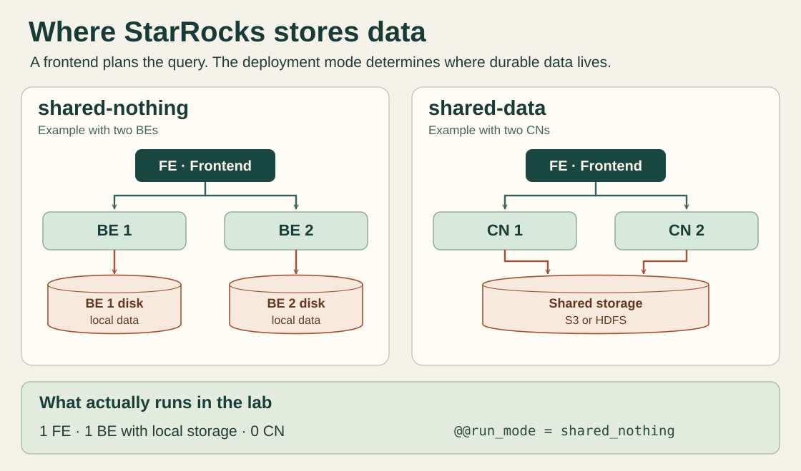

# Analytical databases and the StarRocks architecture

[Lesson slides (PDF)](slides.pdf)

**38-minute lecture · 45 minutes of independent practice after setup · StarRocks 4.1.4**

A cashier needs to correct receipt 102. The café manager wants the number of cups sold in this café on January 3. Both work with sales, but their questions make different demands on a database. Follow a report from the business question to a real StarRocks plan. In the lab you will identify the running services, find the scan and aggregation, and defend a deployment choice.

## Two questions about the same sales

| Task | Data touched | What a good outcome looks like |
| --- | --- | --- |
| Correct one receipt while the till is busy | A known receipt and any related records in the transaction | The database changes belonging to the correction commit together. A separate request-identity contract prevents a repeated payment request from charging twice. |
| Count cups for a date at this café | Many receipts and a few fields | The report uses the agreed date and cup units. It is fresh enough and returns within the dashboard budget. |

**Online transaction processing (OLTP)** describes a workload built from short operations and concurrent changes. **Online analytical processing (OLAP)** describes a workload that compares or summarizes sets of observations. Read/write alone cannot classify them. Fetching one balance can be transactional; loading a corrected day's figures can be part of an analytical workload. One system can support both kinds of query. Measure the mix, the consistency boundary, and the consequences if work contends for the same resources. [PostgreSQL transactions](https://www.postgresql.org/docs/current/tutorial-transactions.html)

## Row storage and column storage

Imagine the same receipts on disk. The brackets below show which values are close together in each simplified layout. A real engine adds page or segment boundaries, encodings and indexes.

| Logical record | Row-oriented layout, one group per receipt |
| --- | --- |
| 100 | [100, Jan 2, espresso, 4] |
| 101 | [101, Jan 3, latte, 2] |
| 102 | [102, Jan 3, espresso, 1] |
| 103 | [103, Jan 3, latte, 3] |

| Field | Column-oriented layout, matching positions across streams |
| --- | --- |
| Receipt | [100, 101, 102, 103] |
| Day | [Jan 2, Jan 3, Jan 3, Jan 3] |
| Drink | [espresso, latte, espresso, latte] |
| Cups | [4, 2, 1, 3] |

A point lookup that needs all fields can benefit from a row layout and an index that locates the receipt. A sum of cups on one date can read the day and quantity streams and skip the drink name, reducing the bytes it needs. Similar values in a column can compress well, depending on order and encoding. Fetching many attributes of a single receipt can require gathering values from multiple places. Indexes, ordering, selectivity, caches, the number of projected columns and write patterns can all change the result. **OLTP/OLAP describes the work; row/column describes a storage choice.** Native StarRocks analytics combines column-oriented execution and storage with parallel workers. [StarRocks features](https://docs.starrocks.io/docs/introduction/Features/)

## Choosing an analytical system

Write down the number of concurrent users, the typical query shape, the required freshness, the owners of writes and the cost boundary before comparing products.

| Candidate | A plausible starting point | What to validate |
| --- | --- | --- |
| PostgreSQL | Checkout transactions and occasional small reports on operational data | Does the reporting mix affect checkout during peak hours? |
| ClickHouse | Interactive analysis of high-volume events, such as a product usage timeline | Benchmark the actual filters, joins, corrections and retention policy. |
| DuckDB | One analyst exploring Parquet files inside a Python process | Can the host handle the dataset and is an embedded workflow sufficient for the audience? |
| BigQuery | A managed warehouse for a team running large SQL reports in Google Cloud | Test query latency, scanned data or reserved capacity, cost, and data location. |
| StarRocks | Concurrent dashboards joining fresh sales to dimensions, including corrected rows | Measure freshness, join data movement, load impact and who will operate the deployment. |

These are starting hypotheses. Run the same representative workload and compare the relevant business measures. [PostgreSQL](https://www.postgresql.org/about/) · [ClickHouse](https://clickhouse.com/docs/intro) · [DuckDB](https://duckdb.org/why_duckdb) · [BigQuery](https://docs.cloud.google.com/bigquery/docs/introduction) · [StarRocks](https://docs.starrocks.io/docs/introduction/Features/)

## Why consider StarRocks?

StarRocks uses massively parallel processing (MPP) to divide work into pieces, execute them concurrently, and combine results. Local sums can reduce how much data must travel to combine a report. A join on shop ID may require workers to exchange rows so matching keys meet. Broadcasting a small dimension can reduce movement of a large fact table, but duplicates the small input at its recipients. Repartitioning a large join can spend substantial time transferring data, and an uneven key distribution can leave one worker with most of the work. Review a representative plan and runtime profile.

Three serving choices have different costs. A native **Primary Key table** can accept replacement images for a receipt ID. The source still has to define which correction wins. An **asynchronous materialized view** stores precomputed results and needs refresh work; the dashboard's freshness requirement determines whether that trade is acceptable. An **external catalog** can query supported data where it already lives. File layout, metadata freshness and remote access can affect a query. A team might start by querying existing files, then bring the frequently updated serving table into StarRocks. [Primary Key tables](https://docs.starrocks.io/docs/table_design/table_types/primary_key_table/) · [Asynchronous materialized views](https://docs.starrocks.io/docs/using_starrocks/async_mv/Materialized_view/) · [External catalogs](https://docs.starrocks.io/docs/data_source/catalog/catalog_overview/)

## Architecture and the request path

The **Frontend (FE)** knows the tables, accepts SQL, plans the work and coordinates execution. A **Backend (BE)** in shared-nothing mode stores native table data on its disks and executes work. A **Compute Node (CN)** in shared-data mode runs work and can cache frequently used data locally. Durable native table data lives in shared storage such as S3 or HDFS.

| Question | Shared-nothing | Shared-data |
| --- | --- | --- |
| What does a worker read? | Its local portion of the data; a distributed query can also exchange intermediate rows. | Cached data when present, otherwise data from shared storage. |
| What happens when adding workers? | Data placement and balancing can matter for distributing work. | Compute capacity can grow independently of durable data; cold workers still need data and bandwidth. |
| What happens on worker loss? | Recovery depends on surviving data replicas and placement. One replica on one BE gives no second local copy. | Losing a CN loses its execution capacity and local cache. Shared data remains subject to the storage service's own durability and availability. |
| What else can fail? | Both modes need healthy FE services, enough compute and network connectivity. | The path to shared storage and its throughput also matter. |



In general computer architecture, **shared-everything** can describe processors sharing memory and disks. In StarRocks **shared-data** means independent compute nodes can access common durable storage. Each worker still has its own memory and cache. These names imply different failure and contention boundaries. [StarRocks architecture](https://docs.starrocks.io/docs/introduction/Architecture/)

For the café report, DataGrip sends SQL to the FE. The FE resolves names and types, constructs a physical plan and schedules work on available workers. Workers read the input, apply the date condition and aggregate cups. A multi-stage plan can combine partial answers across an exchange. The client receives the coordinated result. Plan fragments and exchanges are logical execution boundaries; a single-machine exercise cannot establish cross-machine transfer costs.

## Practice environment

After the conceptual chapters, start Docker Desktop and open the repository folder in VS Code. Run these two commands from its terminal with the course's Python 3.14 and uv environment.

```sh
uv run python lab.py up 01/01
uv run python lab.py setup 01/01
```

In DataGrip create a **MySQL** data source for `127.0.0.1`, port `9030`, user `root` with an empty password, database `course`. Download the driver if prompted. Test the connection, open a console for `course`, and run one supplied statement at a time. Startup time and image download are outside the 45-minute practice allowance. [DataGrip connection setup](https://www.jetbrains.com/help/datagrip/mysql.html)

### 1. Predict two answers · 7 minutes

Without running SQL, find receipt 102 in the opening records above. Record its drink, date and quantity. Predict the number of cups on January 3 and give the receipt numbers behind your answer. Which request could a cashier answer after finding just one record? You will test the aggregate prediction with the live query in exercise 4.

### 2. Match a layout to the work · 8 minutes

Using the four receipts above, circle the values that contribute to a January 3 cup total and identify the fields used to select them. For a correction to receipt 102, list the data a cashier might need to see before confirming the change. Give one condition that could weaken the expected advantage of each layout.

### 3. Inspect this specific server · 10 minutes

```sh
uv run python weeks/01/01/architecture.py
```

This is a read-only report. Open `weeks/01/01/architecture.sql` and execute the statements in DataGrip. Record `current_version()`, `@@run_mode` and the number of live entries in `SHOW FRONTENDS` and `SHOW BACKENDS`. Use the column headers to identify live services. Map each to one responsibility. Explain which observation supports your deployment-mode conclusion. The stand should report the 4.1.4 release and `shared_nothing`, with one live FE and one live BE. Its `SHOW COMPUTE NODES` result has zero registered CNs. IDs, times and addresses depend on your run.

### 4. Read one plan and one result · 12 minutes

Open `weeks/01/01/plan.sql`. Execute its `EXPLAIN` first, the unprefixed `SELECT` next, and `EXPLAIN ANALYZE` last. In the plan locate the scan of `cafe_sales` and an aggregation of `cups`. Find the date condition if your displayed detail includes it. Identify one measured profile value with its unit, or a row counter, and say which operator it belongs to. `EXPLAIN` describes planned work. `EXPLAIN ANALYZE` executes the query and reports measurements. Operator labels, fragment counts and numbers may vary. [EXPLAIN ANALYZE](https://docs.starrocks.io/docs/sql-reference/sql-statements/cluster-management/plan_profile/EXPLAIN_ANALYZE/)

Confirm the result against receipt 101 (two lattes), 102 (one espresso) and 103 (three lattes). Receipt 100 has four cups on January 2. **The January 3 sum is 6.** Optionally execute the supplied `add_receipt.sql` for receipt 104 and repeat the same `SELECT`. Expect **8**. A fresh `setup` restores **6**.

### 5. Defend a deployment choice · 8 minutes

For this hypothetical design, scale beyond the single-café fixture. A regional chain needs a dashboard joining branch information to corrected receipt data. It accepts corrections throughout the day, tolerates a minute of reporting lag, and has a predictable morning spike plus a larger, occasional month-end peak. Its checkout service must still accept payments during reporting failures. Propose a starting system and run mode, name the service that owns payment writes, and describe one alternative under a changed constraint. Pick two measurements for a trial and a failure drill. State one conclusion this one-BE lab cannot support.

**Hand in** your workload/layout comparison, version and node observations, annotated plan, six-cup reconciliation and a short deployment decision. Finish in the VS Code terminal.

```sh
uv run python lab.py check 01/01
uv run python lab.py down 01/01
```

If the connection fails, confirm `up` has finished and recheck port 9030. If the table is missing, run `setup` and select database `course` in the console. If the sum is already eight, an earlier run added 104. Record that fact, then rerun `setup` for the opening example.

## Further investigation

The manager wants the January 3 report split by drink. Predict the number of result rows from the receipts and decide whether the total cups should change. Run the query, then use EXPLAIN in DataGrip. Which additional column must the scan supply?

[DataGrip query](investigate.sql)
